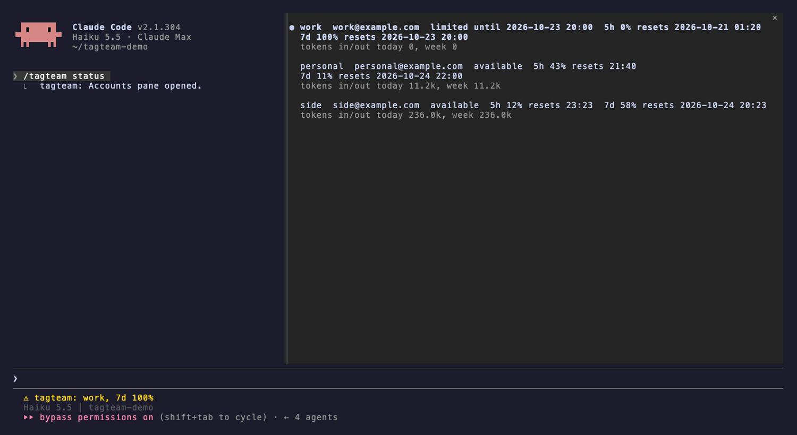
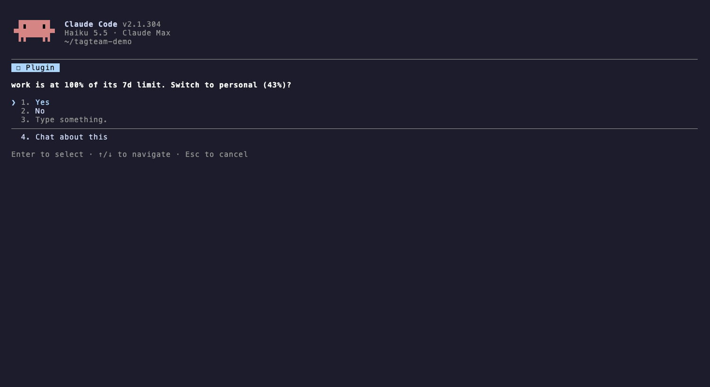

# tagteam

tagteam tracks usage across your own Claude subscription accounts and shows it in a dashboard inside Claude Code. When the account you're on gets close to its limit, it can close your terminal sessions and reopen them on another account with the conversation intact.

tagteam never reads or stores your login. Each account signs in through Anthropic's own page, and Claude Code keeps the login in that account's folder.

Works with Claude Code. Not made by or affiliated with Anthropic. Use of Claude is subject to Anthropic's [Usage Policy](https://www.anthropic.com/legal/aup).

## Install

1. In a Claude Code session, install the plugin:

   ```
   /plugin install tagteam --marketplace jpo-oss/tagteam
   ```

2. Install the launcher. This copies `tagteam` to `~/.local/bin`:

   ```
   /tagteam install
   ```

3. If it says `~/.local/bin` is not on your `PATH`, add this to your shell profile and open a new terminal:

   ```sh
   export PATH="$HOME/.local/bin:$PATH"
   ```

## Usage

1. Add each account with a short label. Add the login you already use too, since every account gets its own folder:

   ```
   /tagteam add work
   /tagteam add personal
   ```

   Your browser opens Anthropic's sign-in page. It signs in whichever claude.ai account the browser has open, so switch there first if needed. tagteam shows the email it got so you can check.

2. Quit Claude and start it again with `tagteam` instead of `claude`. Arguments pass straight through, and it runs fine inside tmux:

   ```sh
   tagteam
   ```

3. Open the dashboard to see every account's usage:

   ```
   /tagteam status
   ```

   

4. When the account you're on reaches the threshold, tagteam asks whether to switch. Say yes and the session closes and reopens on the account with the most room. With auto switch on, it switches without asking and tells you.

   

Other commands:

| Command | What it does |
|---|---|
| `/tagteam` or `/tagteam status` | Opens the dashboard: each account's usage windows, reset times and input/output tokens |
| `/tagteam switch <label>` | Moves this session to that account now; other `tagteam` sessions follow at the end of their turn |
| `/tagteam edit <label> name=<new> order=<n> exclude=true\|false` | Renames, reorders, or takes an account out of rotation |
| `/tagteam remove <label>` | Signs the account out and deletes its folder |

Settings live in `/plugin configure tagteam`:

| Setting | Default | Meaning |
|---|---|---|
| `autoSwitch` | `false` | Switch without asking. When off, one session asks and the rest wait for that answer. No means it won't ask again until that limit window resets. |
| `threshold` | `95` | Usage percentage (50 to 100) that triggers a switch |
| `stallTimeoutSeconds` | `30` | How long the launcher waits for Claude to close itself before stopping it |

Accounts and state live in `~/.claude-accounts`, or `$TAGTEAM_HOME` if you set it. tagteam writes nothing inside `~/.claude`.

## How it works

1. Each account is a folder under `~/.claude-accounts` with links back to your shared settings and history in `~/.claude`.
2. The plugin records every account's usage windows and token counts as your sessions run.
3. When an account crosses the threshold, the plugin picks the account with the most room and writes a switch request at the end of the current turn.
4. The launcher sees the request, closes Claude (stopping it if it hangs on the limit menu), and starts it again on the new account with `--resume`.
5. The first message after the restart tells Claude what happened and to pick up any subagents or background work that were cut off.

If every account is limited, the launcher waits until the soonest reset and resumes there. More detail in [docs/architecture.md](docs/architecture.md).

## Limitations

- Switching only works in the terminal through the `tagteam` launcher. The desktop app and IDE extensions get tracking and warnings, not switching.
- Tested on macOS. Linux should work but hasn't been tested. No Windows support.
- Unattended use needs auto switch on. With it off, the question waits for you.
- State and logins are per machine. Each computer needs its own setup.
- Whether an idle account's login stays valid for days is still being checked.
- A step that was in flight when a session closed gets redone after the restart, and background commands are run again.
- Whether a running workflow resumes across a switch hasn't been verified.

## License

MIT
